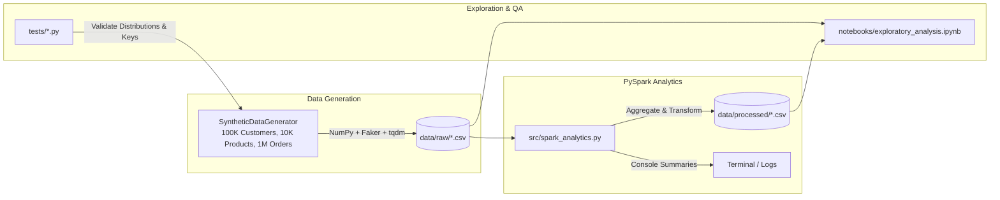

# E-Commerce PySpark Data Pipeline

A modular, production-ready data engineering pipeline built in Python and Apache Spark (PySpark). This project generates realistic relational synthetic e-commerce data using statistical distributions (Normal distribution for age, Pareto 80/20 power law for orders) and performs distributed batch analytics to extract actionable business insights.

---

## 📌 Project Architecture



---

## 📁 Project Directory Structure

```text
genai-pyspark-pipeline/
│
├── data/
│   ├── raw/                           # Generated synthetic Parquet/CSV datasets (unprocessed)
│   │   ├── .gitkeep
│   │   ├── customers.parquet          # 100K Customers (ID, name, email, age, city, country, registration_date)
│   │   ├── products.parquet           # 10K Products (ID, name, category, price, stock, rating)
│   │   └── orders.parquet             # 1M Orders (ID, customer_id, product_id, quantity, order_date)
│   │
│   └── processed/                     # PySpark analysis results & metrics
│       ├── .gitkeep
│       ├── revenue_by_category/       # Total revenue and units sold per product category
│       ├── top_customers/             # Lifetime customer spending ranking (Pareto analyzed)
│       ├── monthly_sales_trend/       # Month-over-Month (MoM) revenue trends
│       ├── age_demographics/          # Revenue and order volume by customer age brackets
│       └── top_products/              # Top 10 bestselling products by gross revenue
│
├── notebooks/
│   ├── .gitkeep
│   └── exploratory_analysis.ipynb     # Interactive Jupyter notebook for PySpark EDA
│
├── src/
│   ├── __init__.py                    # Python package initializer
│   ├── config.py                      # Centralized configuration, paths, and logging
│   ├── data_generator.py              # SyntheticDataGenerator class (NumPy, Faker, tqdm)
│   └── spark_analytics.py             # Distributed PySpark batch processing pipeline
│
├── tests/
│   ├── __init__.py
│   ├── test_config.py                 # Tests for path handling & configurations
│   └── test_data_generator.py         # Tests for schemas, distributions & referential integrity
│
├── .gitignore                         # Python, Spark, and data ignore patterns
├── LICENSE                            # Project license
├── main.py                            # Top-level data generation script (saves raw Parquet)
├── run_analytics.py                   # PySpark execution script (runs analytics & profiles timings)
├── README.md                          # Project documentation and quickstart guide
└── requirements.txt                   # Project dependencies
```

---

## 🛠️ Prerequisites

Before running the pipeline, ensure the following are installed on your system:

1. **Python 3.9+** (Python 3.10 or 3.11 recommended).
2. **Java Development Kit (JDK 8, 11, or 17)**: Apache Spark requires a JVM runtime.
   - Verify with: `java -version`
   - If not installed, download from [Adoptium Eclipse Temurin](https://adoptium.net/).

---

## 🚀 Setup & Installation

### 1. Clone or Open the Repository
```bash
cd genai-pyspark-pipeline
```

### 2. Create and Activate a Virtual Environment

**On Linux/macOS:**
```bash
python3 -m venv .venv
source .venv/bin/activate
```

**On Windows (PowerShell):**
```powershell
python -m venv .venv
.\.venv\Scripts\Activate.ps1
```

### 3. Install Required Dependencies
```bash
pip install --upgrade pip
pip install -r requirements.txt
```

---

## ⚡ Execution Guide

### Step 1: Generate Synthetic Data (100K Customers, 10K Products, 1M Orders)
Run the top-level `main.py` pipeline to generate and export compressed Parquet datasets:
```bash
python main.py
```

Or run the module directly:
```bash
python -m src.data_generator
```

Or invoke the `SyntheticDataGenerator` class programmatically in Python:
```python
from src.data_generator import SyntheticDataGenerator

# Initialize with default 100K customers, 10K products, 1M orders
generator = SyntheticDataGenerator(
    num_customers=100_000,
    num_products=10_000,
    num_orders=1_000_000,
    seed=42,
)

# Generate individual DataFrames or run all at once
datasets = generator.generate_all(save_to_disk=True)

customers_df = datasets["customers"]
products_df = datasets["products"]
orders_df = datasets["orders"]
```

#### Statistical Distributions Implemented:
- **Customer Age**: Normal distribution centered around 35 years ($\mu = 35$, $\sigma = 10$), clipped between 18 and 75.
- **Customer Orders**: Pareto power law distribution ($P(X \le 0.20) = 0.80$), where **20% of customers generate ~80% of all orders**.
- **Referential Integrity**: Every order date is guaranteed to occur **on or after** that customer's account registration date.

---

### Step 2: Run PySpark Analytics Pipeline
Execute distributed PySpark transformations on the generated data:
```bash
python -m src.spark_analytics
```

This will:
1. Ingest the raw CSV datasets into PySpark with predefined schemas.
2. Execute business queries across categories, customers, time series, and demographics.
3. Print summary tables to the terminal.
4. Export partitioned CSV summaries to `data/processed/`.

---

### Step 3: Run Unit Tests
Validate data generator distributions, schemas, and referential integrity:
```bash
pytest -v
```

---

### Step 4: Interactive Notebook Exploration
Launch the interactive Jupyter notebook to visualize revenue trends and charts:
```bash
jupyter notebook notebooks/exploratory_analysis.ipynb
```

---

## 📊 Business Insights Calculated

| Insight Metric | Description | Output Location |
| :--- | :--- | :--- |
| **Revenue by Category** | Aggregates realized revenue, units sold, and average price across `Electronics`, `Clothing`, `Home`, `Sports`, and `Books`. | `data/processed/revenue_by_category/` |
| **Top 10 Customers** | Identifies highest lifetime spenders based on Pareto order distribution. | `data/processed/top_customers/` |
| **Monthly Sales Trend** | Computes month-over-month (MoM) revenue growth using Spark window functions (`F.lag`). | `data/processed/monthly_sales_trend/` |
| **Age Demographics** | Measures sales volume across customer age brackets (`<25`, `25-34`, `35-44`, `45-54`, `55+`). | `data/processed/age_demographics/` |
| **Top Bestselling Products** | Ranks top products by gross revenue and units sold. | `data/processed/top_products/` |
